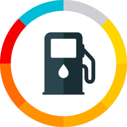

[](https://github.com/oOBenjaminOo/HA-drivvo/actions/workflows/hassfest.yaml)
[](https://github.com/oOBenjaminOo/HA-drivvo/actions/workflows/hacs.yaml)

# Drivvo Custom Integration Home Assistant



Custom integration for the Home Assistant to obtain information present in [drivvo.com](https://www.drivvo.com/).

## Maintained continuation / Reprise de maintenance

Maintained by [Benjamin (@oOBenjaminOo)](https://github.com/oOBenjaminOo), based on upstream 3.1.0 by Hudson Brendon and contributors, including @dougiteixeira. The original MIT copyright and license are preserved in LICENSE. Upstream recovery commit: `24159f2dcf0462feb1dbc68caff8fda394b67a3d`.

### 3.1.2

- Fix the Drivvo options dialog on current Home Assistant versions.
- Let Home Assistant retry setup after a temporary Drivvo API failure. A missing-vehicle repair appears only when a successful vehicle-list response confirms the vehicle is absent.
- Show a connection error during setup, reauthentication or configuration when Drivvo cannot be reached.
- All 116 automated tests passed locally on Home Assistant 2026.10.4 / Python 3.14.

[Release notes for 3.1.2](https://github.com/oOBenjaminOo/HA-drivvo/releases/tag/v3.1.2)

### 3.1.1

- Correct remaining-fuel device classes to `volume_storage` / `energy_storage`; retain measurement statistics, entity IDs and units.
- Restore and adapt upstream HTTP mocks to current aiohttp; include all optional API endpoints in fixtures.
- Add regression coverage for litres, US gallons, kWh and unsupported imperial gallons.
- 93 automated tests pass on Home Assistant 2026.10.4 / Python 3.14.
- Live read validation: two vehicles, 92 loaded entities, none unavailable on the maintainer's test installation. Write services have not been exercised against the live account during this validation.

### Migration depuis l'ancienne integration

Conserver l'entree Drivvo existante : ne pas la supprimer puis la recreer. Le domaine `drivvo`, les cles et les identifiants restent identiques. Sauvegarder Home Assistant avant remplacement des fichiers. Retirer uniquement l'ancien suivi HACS si necessaire, sans supprimer l'integration active ni ses donnees. Ne jamais publier les identifiants Drivvo ou les fichiers `.storage`.

## What's new in 3.1.0

- **Maintenance reminders**: `lembrete` is now read, and the due date/odometer is
  derived the way the Drivvo app does it, plus a `binary_sensor` that turns on
  when anything is overdue.
- **Write-back is back**, with the POST payloads verified against the live API
  (create + delete round-trip on every module) rather than inferred.
- **Units follow your Drivvo account** — km/mi/hours, litres/US gallons/imperial
  gallons and all twelve fuel-efficiency units, instead of being fixed to km and
  km/L.
- **Three bug fixes**: dates were off by the account's UTC offset, the general
  fuel average counted fuel burnt before the measurement started, and service and
  expense values always read `0`.
- New sensors for tank level and range, electric charging, income, routes,
  odometer readings, checklists, licence plate and driving-licence expiry.

## Install

### Installation via HACS

1. Open HACS in Home Assistant and search for **Drivvo**.
2. Select **Drivvo** and click **Download**.
3. Restart Home Assistant.

### Manual installation

- Copy `drivvo`  folder from [latest release](https://github.com/oOBenjaminOo/HA-drivvo/releases/latest) to your `<config dir>/custom_components/` directory.
- Restart the Home Assistant.

## Configuration

Adding Drivvo to your Home Assistant instance can be done via the UI using this button:

[](https://my.home-assistant.io/redirect/config_flow_start?domain=drivvo)

### Manual Configuration

If the button above doesn't work, you can also perform the following steps manually:

* Navigate to your Home Assistant instance.
* In the sidebar, click Settings.
* From the Setup menu, select: Devices & Services.
* In the lower right corner, click the Add integration button.
* In the list, search and select `Drivvo`.
* Follow the on-screen instructions to complete the setup.

## Available Sensors

One device per vehicle. Sensors marked *(disabled)* are created disabled — turn
them on in the entity settings if you use that part of Drivvo.

### Vehicle

- **Vehicle** — attributes carry plate, year, chassis, renavam, tank volume,
  purchase/sale value and the account units
- **License Plate**, **Odometer**, **Odometer Date**
- **Tank Volume** *(disabled)*

### Refuelling

- **Refuelling Total**, **Date**, **Odometer**, **Station**, **Type**, **Reason**
- **Last Average**, **General Average**
- **Value**, **Price**, **Price Lowest**, **Value Total**
- **Volume**, **Volume Total**, **Tank Full**, **Distance**
- **Fuel Cost per Distance**, **Cost Total**
- **Refuelling Payment Method** *(disabled)*

### Tank estimate

Needs a tank volume registered on the vehicle in Drivvo.

- **Fuel Level** (%), **Fuel Remaining**, **Range**

### Maintenance reminders

- **Next Reminder** — the `reminders` attribute lists every reminder with its due
  date, due odometer and overdue flag
- **Next Reminder Date**, **Next Reminder Odometer**, **Next Reminder Days**,
  **Next Reminder Distance**
- **Reminders Total**, **Reminders Overdue**
- **binary_sensor: Maintenance Due** — on when any reminder is overdue

### Services and expenses

- **Service Total**, **Date**, **Odometer**, **Description**, **Value**,
  **Place**, **Value Total**
- **Expense Total**, **Date**, **Type**, **Description**, **Value**,
  **Value Total**, **Odometer** *(disabled)*

### Electric vehicles *(disabled)*

- **Charge Battery Start**, **Charge Battery End**, **Charge Duration**,
  **Charge Energy**

### Other modules *(disabled)*

- Income, routes, odometer readings and checklists
- **Driver License Expiry**
- **binary_sensor: Last Refuelling Full Tank**

## Services

The integration writes back to Drivvo.

| Service | What it does |
| --- | --- |
| `drivvo.add_refuelling` | Logs a refuelling |
| `drivvo.add_reading` | Logs an odometer reading |
| `drivvo.add_expense` | Logs an expense |
| `drivvo.add_service` | Logs a service |
| `drivvo.add_income` | Logs an income |
| `drivvo.refresh` | Fetches data now instead of waiting for the daily update |

`vehicle_id` is the Drivvo vehicle id picked during setup. Fuels, stations,
places and expense/service/income types are given by **name** and must already
exist in your Drivvo account; when a name does not match, the error lists the
names that do.

```yaml
action: drivvo.add_refuelling
data:
  vehicle_id: "4611323"
  odometer: 81000
  total_value: 227.74
  price: 5.99
  full_tank: true
  station: Posto Natal II
```

```yaml
action: drivvo.add_reading
data:
  vehicle_id: "4611323"
  odometer: 81500
```

Give any two of `total_value`, `price` and `volume` — the third is derived.

## Units

Distance, volume and fuel efficiency follow the units set in your Drivvo account
(`unidade_distancia`, `unidade_medida`, `eficiencia_combustivel`), so a vehicle
measured in miles and US gallons reports mpg, and one measured in hours reports
consumption per hour.

## How the numbers are calculated

The API returns raw records and no computed report — the Drivvo app does the
maths client-side, and this integration reproduces it:

- **Fuel averages** are measured between two full tanks. Fuel put in before the
  first full tank was burnt over an unknown distance, so it is excluded; partial
  fills in between are added; a refuelling flagged "forgot the previous one"
  restarts the measurement.
- **Reminder due points** come from the last entry of the watched expense or
  service type plus the reminder's interval, in distance or in days/months/years.
- **Dates** are returned in your account's local time and are read in the Home
  Assistant timezone.

## Debugging

To enable debug for Drivvo integration, add following to your `configuration.yaml`:
```yaml
logger:
  default: info
  logs:
    custom_components.drivvo: debug
```
